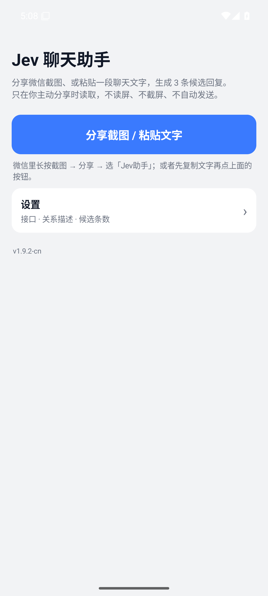
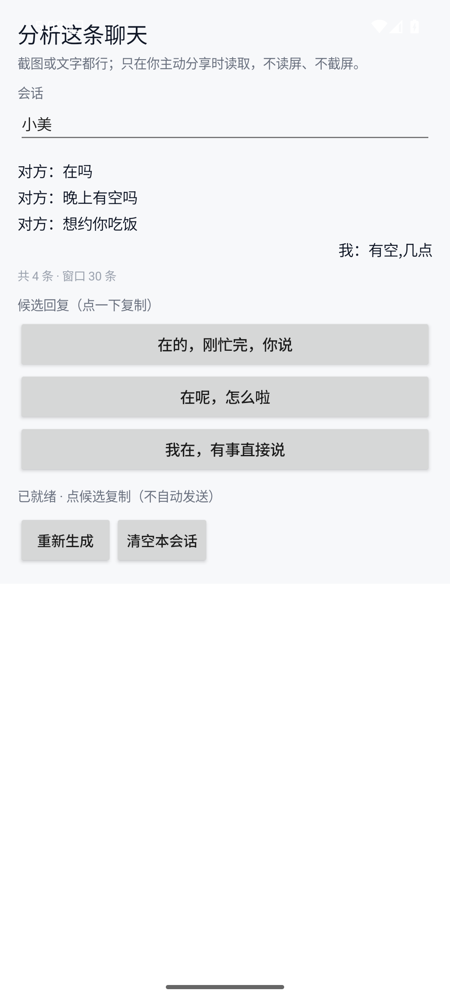
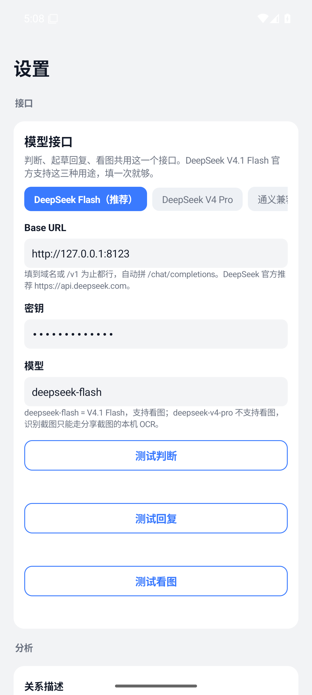

<div align="center">


# Jev 聊天助手 · 国内版（Android）

[原项目（上游）](https://github.com/jev-chat/jev-chat-jarvis) · [下载 v1.9.2 APK](https://github.com/KevinZjYang/jev-assistant-cn/releases/tag/v1.9.2-cn) · [更新日志](cn/CHANGELOG.md) · [隐私政策](cn/PRIVACY.md)

**简体中文** · [English](cn/README.en.md)

</div>

> 本项目是 [jev-chat/jev-chat-jarvis](https://github.com/jev-chat/jev-chat-jarvis)（MIT）的国内化分支：
> 输入方式从「App 读屏」改成「你主动分享截图 / 粘贴文字」，接口默认指向 DeepSeek。
> 上游的完整能力、原理与协议说明请看原项目。

## 截图

<table align="center">
<tr>
<td align="center"><br/><sub>首页：没有权限向导，只有一个「分享截图 / 粘贴文字」</sub></td>
<td align="center"><br/><sub>分享截图后：认出 4 条消息，给 3 条候选，点一下复制</sub></td>
<td align="center"><br/><sub>设置页：判断 / 回复 / 看图共用一份接口</sub></td>
</tr>
</table>

## 为什么改了输入方式

微信从 8.0.5x 起把消息文字从无障碍节点里藏了起来，部分账号的聊天页还带上了 `FLAG_SECURE`：

- `screencap`、系统截屏键、无障碍 `takeScreenshot`、`MediaProjection`、adb、投屏、录屏——全部拿不到画面，只有一片黑；
- 这不是本 App 能绕的：所有截图路径都走 SurfaceFlinger 同一层合成，SECURE 窗口根本不进可捕获缓冲区；
- 上游有同样的记录：[Issue #42](https://github.com/jev-chat/jev-chat-jarvis/issues/42)，最后只有「卸载重装微信」能恢复，上游 v1.4 宣布微信不再支持。

所以这一版把输入从「App 自己看屏幕」换成「你把内容递给它」：

| | 上游 | 本项目 |
|---|---|---|
| 输入 | 无障碍读屏 + 悬浮窗卡片 | 分享截图 / 粘贴文字 |
| 需要的权限 | 无障碍、悬浮窗、自启动 | **无** |
| 微信 | 读屏不可用 | 分享截图可用（前提是微信本身还能截屏） |
| 接口 | 判断 / 回复 / 视觉三张卡 | 一张卡，三用途共用 |
| 自动发送 | 从不 | 从不 |

## 为什么用它

- **只在你主动分享时读。** 不后台读屏、不自动截屏、不 hook、不改微信、不读它的数据库。
- **发送权永远在你手里。** 点候选只是复制（无障碍在跑且输入框已聚焦时直接填进去），发送键永远由你自己点。
- **它先判断，再写字。** 先把这段话整理成「谁说的、想干什么」的结构交给模型，再起草候选，而不是让模型凭空编一句。
- **跨截图能接上。** 同一段对话连拍两张，靠「最长重合段」把第二张接在第一张后面；接不上会明说「可能与前文不连续」，不硬拼。
- **本机 OCR，零上传图片。** 截图用 ML Kit 中文模型在本机识别，不上传、零 token。
- **接口自己配。** 默认 DeepSeek（`https://api.deepseek.com` + `deepseek-flash`），也可换通义兼容或任意 OpenAI 兼容地址；作者不运营中转服务器。
- **本机存储可控。** 密钥在 App 私有 SharedPreferences，会话在 `files/sessions/`，「清空本会话」即时删除。

## 快速开始

**1. 装包。** 从 [Releases](https://github.com/KevinZjYang/jev-assistant-cn/releases) 下载 `jev-assistant-1.9.2-cn.apk`（Android 11+，仅 `arm64-v8a`）。

```bash
adb install -r jev-assistant-1.9.2-cn.apk
```

**2. 填接口。** 打开 App → 设置 →「模型接口」：Base URL `https://api.deepseek.com`、模型 `deepseek-flash`、填你的 DeepSeek 密钥，三个按钮各点一次确认连通（判断 / 回复 / 看图）。

**3. 开始用。** 回首页点「分享截图 / 粘贴文字」；或者在微信里长按截图 → 分享 → 选「Jev助手」。看候选 → 点一条复制 → 回微信粘贴 → 自己按发送。

没有第 4 步：**不需要开无障碍、不需要悬浮窗、不需要自启动。**

## 功能

### 判断与候选回复

- 判断与起草共用一份接口：`state`（最近消息 + 关系描述）→ 判断 → 起草 3 条口语化候选。
- 候选点一下：先尝试 `ACTION_SET_TEXT` 写进输入框（需要无障碍），失败退剪贴板并提示长按粘贴。
- 会话可以手动命名，也可以从截图顶部自动取（避开状态栏文字）。

### 跨截图连续会话

- 第二张图的头几条通常与第一张重叠，`OverlapMerger` 找最长重合段（最多 20 条），只追加重合之后的部分。
- 滚动窗口默认 30 条，更早的内容压成 ≤600 字摘要挂在会话上。
- 找不到重合 → 标 `anchored=false`，卡片上提示「这段与前文可能不连续」。

### 分边：谁说的

- 主判据是**气泡底色**：自己的绿、对方的白（深色模式也有明度差）；在气泡中线横向采 9 个点，绿色过半判「我」。
- 底色读不出（灰底、纯文字截图）才退回几何：所有气泡的左边缘最小值、右边缘最大值当两条参考列，看每条贴哪列。
- 早期版本用的是「离哪条屏幕边更近」，长消息（接近全宽）会随机翻转，已修，并用真实事故坐标写了回归用例。

### 接口与模型

- 一张卡：`DeepSeek Flash（推荐）/ DeepSeek V4 Pro / 通义兼容 / 自定义`，Base URL、密钥、模型三栏，判断 / 回复 / 看图共用。
- 端点自动拼 `/chat/completions`，Base URL 填到域名或 `/v1` 都行。
- `deepseek-flash`（V4.1 Flash）支持看图；`deepseek-v4-pro` 不支持，识别截图时只能走本机 OCR。
- 老版本单独存过的回复 / 视觉配置会在升级时清一次，改为跟随主接口。

## 常见问题

<details>
<summary><b>它会替我发消息吗？</b></summary>

不会。点候选只做两件事：尝试填进输入框、或复制到剪贴板。发送键永远由你点，转账 / 红包 / 收款一律不碰。

</details>

<details>
<summary><b>需要 root 或 Xposed 吗？</b></summary>

不需要，也不用装任何模块。分享流程甚至不需要无障碍权限——只有「点候选直接填进微信输入框」这一步需要。

</details>

<details>
<summary><b>为什么不能像上游那样自动读屏？</b></summary>

微信把消息文字藏起来了，部分账号的聊天页还开了 `FLAG_SECURE`，读屏和截屏都拿不到内容。要绕过只能 root + LSPosed 去 `FLAG_SECURE`，与「不改微信、不 root」的前提冲突。

</details>

<details>
<summary><b>我的聊天内容会被上传吗？</b></summary>

触发分析时，当前会话的文字（就是你分享的那张图里认出来的消息）会发到你自己配置的模型接口；图片本身在本机 OCR，不上传。作者不运营中转服务器，收不到任何内容。会话只存在手机私有目录，可一键清空。

</details>

<details>
<summary><b>为什么我的微信聊天页截不了图，连系统截屏都提示「当前页面不允许截图」？</b></summary>

这是微信侧的 `FLAG_SECURE` 保护状态，不是本 App 造成的。已知的恢复办法是备份聊天记录 → 卸载微信 → 重装；装过读屏类助手后触发的情况，上游 [Issue #42](https://github.com/jev-chat/jev-chat-jarvis/issues/42) 有完整记录。

</details>

<details>
<summary><b>群聊支持得怎么样？</b></summary>

弱。没有昵称列，只能靠底色 / 边缘分边，多人交替说话时可能把两次发言合成一条。

</details>

## 项目结构

```
cn/           国内版 Android 工程（Kotlin，传统 View，无 Compose）
  app/src/main/java/com/jev/probe/
    ShareReceiverActivity.kt   分享 / 粘贴入口，出候选
    session/                   会话模型、重叠合并、落盘
    capture/ocr/               截图解析（ML Kit OCR → 气泡分组 → 分边）
    jev/                       判断 / 回复 / 视觉客户端
    core/Prefs.kt              配置（单接口，默认 DeepSeek）
global/       上游国际版工程，原样保留
docs/         验收与方案文档
```

## 构建

需要 JDK 17 + Android SDK（platform 35、build-tools 35.0.0）。

```bash
cd cn
echo "sdk.dir=/path/to/Android/Sdk" > local.properties
./gradlew assembleRelease
```

签名从环境变量 `JEV_KEYSTORE_PROPS` 指向的 properties 读取（`storeFile` / `storePassword` / `keyAlias` / `keyPassword`），不设则输出未签名包。想打模拟器测试包可加 `-PjevAbi=x86_64`。

单测：`./gradlew testReleaseUnitTest`（45 个用例，覆盖分边、重叠合并、门限与输入写入）。

## 致谢与许可

MIT，见 [LICENSE](LICENSE)、[NOTICE](NOTICE)。

- 上游：[jev-chat/jev-chat-jarvis](https://github.com/jev-chat/jev-chat-jarvis)（Android / macOS / Windows），本项目的协议设计、判断题目集、适配器骨架与文档都来自那里；
- 上游 WhatsApp 读取规则来自 [@smgonthebeat](https://github.com/smgonthebeat)（#73）；
- 上游桌面版：[macOS](https://github.com/jev-chat/jev-chat-jarvis-mac) · [Windows](https://github.com/jev-chat/jev-chat-windows)。

本分支的改动同样以 MIT 发布。
